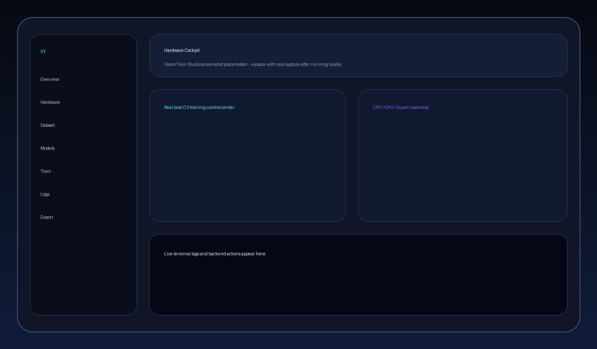
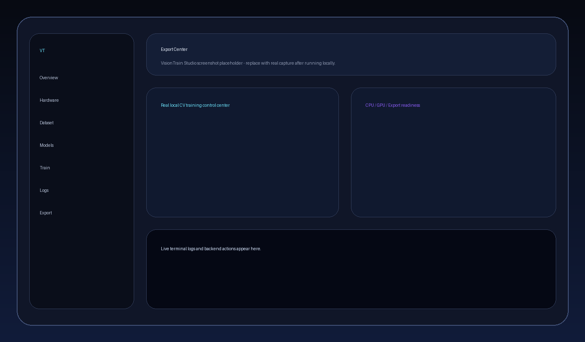

# VisionTrain Studio


**A professional local AI training control center for computer vision engineers.**

VisionTrain Studio is a local-first portfolio-grade MLOps product for guided computer vision training. It combines a premium Vanilla JS dashboard, a FastAPI backend, real training backends, hardware-aware model compatibility, dataset validation, live logs, experiment history, and model export/conversion workflows.

It is intentionally honest: it does not claim to train every model in the world. Every model marked **Supported** has a real Python trainer behind it. Future integrations are visible but disabled.

---

## Screenshots

> Lightweight screenshot previews are included so the README renders cleanly on GitHub. Replace them with live captures after running the app locally.







---

## What this project solves

Many portfolio CV projects stop at a pretty frontend or a single training script. VisionTrain Studio shows the full engineering loop:

- guided dataset selection and validation
- hardware detection for CPU/GPU machines
- model registry with compatibility rules
- real training launches through backend trainers
- live logs and clear error messages
- JSON config import/export
- experiment history
- ONNX / TensorRT-aware export center
- Windows setup automation

---

## Architecture

```text
VisionTrain Studio
├── Frontend: HTML + CSS + Vanilla JS
│   ├── premium dark command-center UI
│   ├── hardware cockpit
│   ├── dataset health panel
│   ├── model registry matrix
│   ├── train/export controls
│   └── live log polling
│
├── Backend: FastAPI
│   ├── hardware profiler
│   ├── CPU/GPU monitors
│   ├── dataset validator
│   ├── model compatibility service
│   ├── training router
│   ├── experiment store
│   └── export router
│
├── Trainers
│   ├── Ultralytics YOLO / RT-DETR trainer
│   ├── PyTorch/TorchVision classification trainer
│   ├── TorchVision semantic segmentation trainer
│   ├── TorchVision COCO detection starter
│   ├── PyTorch autoencoder anomaly trainer
│   └── OCR future integration hook
│
└── Exporters
    ├── PyTorch checkpoint to ONNX
    ├── Ultralytics export wrapper
    ├── TensorRT availability gate
    └── PyTorch precision converter
```

Detailed docs:

- [Architecture](docs/architecture.md)
- [Dataset Formats](docs/dataset_formats.md)
- [Export Guide](docs/export_guide.md)
- [Troubleshooting](docs/troubleshooting.md)

---

## Real supported models

### Ultralytics models

| Model | Task | Trainer | Dataset | CPU | GPU |
|---|---|---|---|---:|---:|
| YOLOv8n Detection | Object detection | `yolo_trainer.py` | YOLO | Yes | Yes |
| YOLOv8s Detection | Object detection | `yolo_trainer.py` | YOLO | Yes | Yes |
| YOLOv8m Detection | Object detection | `yolo_trainer.py` | YOLO | Yes | Yes |
| YOLOv8n Segmentation | Instance segmentation | `yolo_trainer.py` | YOLO | Yes | Yes |
| YOLOv8s Segmentation | Instance segmentation | `yolo_trainer.py` | YOLO | Yes | Yes |
| YOLOv8n Classification | Classification | `yolo_trainer.py` | ImageFolder | Yes | Yes |
| YOLOv8n Pose | Pose estimation | `pose_trainer.py` | YOLO pose | Yes | Yes |
| RT-DETR-L | Detection | `yolo_trainer.py` | YOLO | Yes | Yes |

RT-DETR support depends on the installed Ultralytics package supporting the selected RT-DETR weights.

### PyTorch / TorchVision classification

| Model | Trainer | Dataset |
|---|---|---|
| ResNet18 | `classification_trainer.py` | ImageFolder |
| ResNet50 | `classification_trainer.py` | ImageFolder |
| MobileNetV3 Small | `classification_trainer.py` | ImageFolder |
| MobileNetV3 Large | `classification_trainer.py` | ImageFolder |
| EfficientNet-B0 | `classification_trainer.py` | ImageFolder |
| ConvNeXt Tiny | `classification_trainer.py` | ImageFolder |
| ViT-B/16 | `classification_trainer.py` | ImageFolder |

### TorchVision semantic segmentation

| Model | Trainer | Dataset |
|---|---|---|
| DeepLabV3 ResNet50 | `segmentation_trainer.py` | image/mask folders |
| FCN ResNet50 | `segmentation_trainer.py` | image/mask folders |
| LR-ASPP MobileNetV3 | `segmentation_trainer.py` | image/mask folders |

### TorchVision detection starter

| Model | Trainer | Dataset |
|---|---|---|
| Faster R-CNN ResNet50 FPN | `detection_torchvision_trainer.py` | COCO-style |
| RetinaNet ResNet50 FPN | `detection_torchvision_trainer.py` | COCO-style |
| SSD300 VGG16 | `detection_torchvision_trainer.py` | COCO-style |

Training is real. Full COCO mAP evaluation is marked as roadmap because adding a robust evaluator would make the starter heavier.

### Anomaly detection

| Method | Trainer | Dataset |
|---|---|---|
| Convolutional autoencoder | `anomaly_trainer.py` | normal/anomaly folders |

---

## Future integrations, not fake supported

These are visible in the registry but disabled until real trainer/export code is added:

- Mask R-CNN instance segmentation
- RTMDet / MMDetection
- Detectron2 models
- PaddleOCR / EasyOCR training
- INT8 TensorRT export with calibration

---

## Hardware-aware model compatibility

The backend endpoint `/api/hardware-profile` detects:

- CPU name, cores, usage
- RAM total/available/used
- recommended CPU batch sizes
- CUDA availability
- GPU count/name
- VRAM total/allocated/reserved
- CUDA version
- cuDNN version
- compute capability
- FP16/BF16 support
- TensorRT package availability
- ONNX / ONNX Runtime / ONNX Runtime GPU provider availability

The endpoint `/api/model-compatibility` combines hardware + installed packages + `models.json` and returns per-model:

- enabled or disabled
- reason
- warnings
- recommended batch size
- recommended image size
- recommended precision
- missing dependency

The UI disables unsuitable models and shows the reason, for example:

- `Requires CUDA GPU`
- `Ultralytics is not installed`
- `Recommended VRAM 8 GB, detected 4 GB`
- `Future integration`
- `Dataset format mismatch`

---

## Dataset formats

### YOLO detection / segmentation / pose

```text
dataset/
  dataset.yaml
  images/
    train/
    val/
  labels/
    train/
    val/
```

### Classification

```text
dataset/
  train/
    class_1/
    class_2/
  val/
    class_1/
    class_2/
```

### Semantic segmentation

```text
dataset/
  images/
    train/
    val/
  masks/
    train/
    val/
```

### COCO detection

```text
dataset/
  images/
    train/
    val/
  annotations/
    train.json
    val.json
```

### Anomaly detection

```text
dataset/
  train/
    normal/
  val/
    normal/
    anomaly/
```

---

## Windows setup

Run:

```bat
scripts\setup_windows.bat
```

The setup script:

1. detects Python
2. detects Conda
3. asks for CPU or NVIDIA GPU mode
4. creates Conda env `visiontrain` if Conda exists
5. falls back to `.venv` if Conda is unavailable
6. installs PyTorch CPU or CUDA build based on your choice
7. installs app dependencies
8. creates required folders
9. runs dependency checks
10. runs GPU check when GPU mode is selected

---

## One-command app launcher

After setup, run:

```powershell
powershell -ExecutionPolicy Bypass -File scripts/start_visiontrain.ps1
```

The launcher:

- detects project root
- activates Conda env `visiontrain` or `.venv`
- starts FastAPI on `127.0.0.1:8000`
- starts frontend server on `127.0.0.1:5173`
- opens the browser automatically
- writes logs to:
  - `backend/logs/backend_runtime.log`
  - `backend/logs/frontend_runtime.log`
- stops child processes when the terminal closes

To stop manually:

```powershell
powershell -ExecutionPolicy Bypass -File scripts/stop_visiontrain.ps1
```

---

## Training workflow

1. Run setup.
2. Start the app with PowerShell.
3. Open the Dataset page.
4. Enter a local dataset path and format.
5. Validate dataset.
6. Open Models.
7. Pick an enabled model.
8. Set training parameters.
9. Start training.
10. Watch live logs.
11. Check experiment history.
12. Export checkpoint when ready.

Training command preview:

```bash
python -m backend.trainer.train_router --config backend/configs/saved/current_config.json
```

---

## Export / conversion workflow

Supported workflows:

- PyTorch `.pt` / `.pth` classification or anomaly checkpoint to ONNX
- Ultralytics YOLO / RT-DETR export using real Ultralytics API
- Ultralytics TorchScript / OpenVINO export when supported by local package
- TensorRT engine export only when CUDA + TensorRT are detected
- PyTorch FP16 checkpoint conversion for compatible state dictionaries

Example export command:

```bash
python -m backend.exporter.export_router --checkpoint backend/runs/exp001/best.pt --format onnx --precision fp16 --imgsz 640 --opset 17
```

TensorRT is not faked. If missing, the UI disables engine export and shows:

```text
TensorRT not detected. Install NVIDIA TensorRT and CUDA-compatible PyTorch to enable engine export.
```

---

## API endpoints

| Method | Endpoint | Purpose |
|---|---|---|
| GET | `/api/health` | API health and trainer mapping |
| GET | `/api/system-info` | General system info |
| GET | `/api/hardware-profile` | Full CPU/GPU/package profile |
| GET | `/api/cpu-monitor` | CPU training dashboard values |
| GET | `/api/gpu-monitor` | GPU training dashboard values |
| GET | `/api/models` | Raw model registry |
| GET | `/api/model-compatibility` | Hardware-aware model availability |
| GET | `/api/default-config` | Default JSON config |
| POST | `/api/validate-dataset` | Validate dataset format |
| POST | `/api/start-training` | Start real training |
| POST | `/api/stop-training` | Request stop |
| GET | `/api/training-status` | Training state |
| GET | `/api/training-logs` | Live training logs |
| GET | `/api/experiments` | Experiment history |
| POST | `/api/save-config` | Save JSON config |
| POST | `/api/import-config` | Normalize imported config |
| GET | `/api/export/capabilities` | Export availability |
| POST | `/api/export/onnx` | ONNX export |
| POST | `/api/export/tensorrt` | TensorRT export if available |
| POST | `/api/export/torchscript` | TorchScript export |
| POST | `/api/export/openvino` | OpenVINO export through Ultralytics |
| POST | `/api/export/precision` | Precision conversion |
| GET | `/api/export/status` | Export status |
| GET | `/api/export/logs` | Export logs |

---

## Folder structure

```text
VisionTrain-Studio/
  frontend/
    index.html
    style.css
    app.js
    assets/
  backend/
    __init__.py
    main.py
    trainer/
      base_trainer.py
      train_router.py
      yolo_trainer.py
      classification_trainer.py
      segmentation_trainer.py
      detection_torchvision_trainer.py
      pose_trainer.py
      anomaly_trainer.py
      ocr_trainer.py
      dataset_validator.py
      config_manager.py
      log_streamer.py
      system_info.py
      gpu_monitor.py
      cpu_monitor.py
      hardware_profiler.py
      model_compatibility.py
      experiment_store.py
    exporter/
      export_router.py
      onnx_exporter.py
      tensorrt_exporter.py
      precision_converter.py
      export_validator.py
    configs/
      default_config.json
      models.json
      task_schema.json
      saved/
    runs/
    datasets/
    logs/
    requirements.txt
    environment.yml
  scripts/
    setup_windows.bat
    run_backend.bat
    run_frontend.bat
    check_gpu.bat
    clean_runs.bat
    start_visiontrain.ps1
    stop_visiontrain.ps1
  docs/
    architecture.md
    dataset_formats.md
    export_guide.md
    troubleshooting.md
    screenshots/
  .github/workflows/python-checks.yml
  README.md
  .gitignore
  ACCEPTANCE_CHECKS.json
```

---

## Portfolio value

This project demonstrates:

- AI engineering: real model training workflows
- Computer vision: detection, segmentation, classification, anomaly pipelines
- MLOps thinking: configs, logs, experiment history, exports
- Backend engineering: FastAPI service design and error handling
- Windows automation: `.bat` setup and PowerShell launcher
- UI/UX product design: operational dashboard, not a fake prototype
- Honest engineering: unsupported tools are disabled, not simulated

---

## Honest limitations

- Actual training requires valid local datasets and installed dependencies.
- Full COCO mAP evaluation for TorchVision detection is roadmap.
- TensorRT export requires a real local TensorRT + CUDA environment.
- OCR training is a future integration hook, not a fake trainer.
- MMDetection/Detectron2 are future integrations due to heavier environment setup.
- INT8 export requires calibration dataset logic and is intentionally disabled.

---

## Roadmap

- Full COCO mAP evaluator
- Rich metrics plots
- TensorBoard integration
- Resume training UI
- Multi-run comparison
- Real PaddleOCR integration
- MMDetection plugin installer
- Docker support for Linux GPU machines
- Dataset split utility
- Model card generation after training
