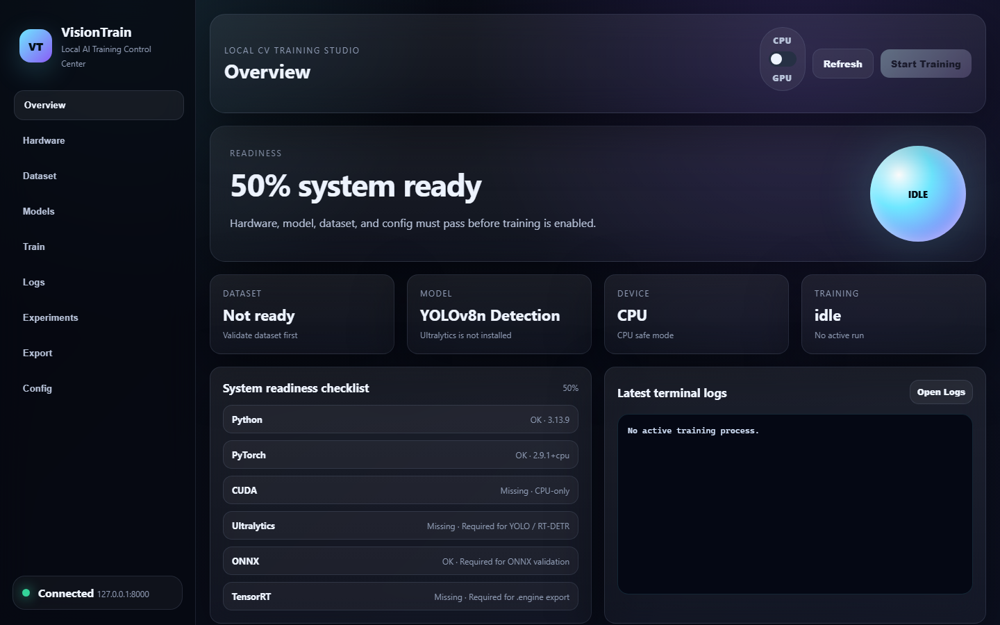
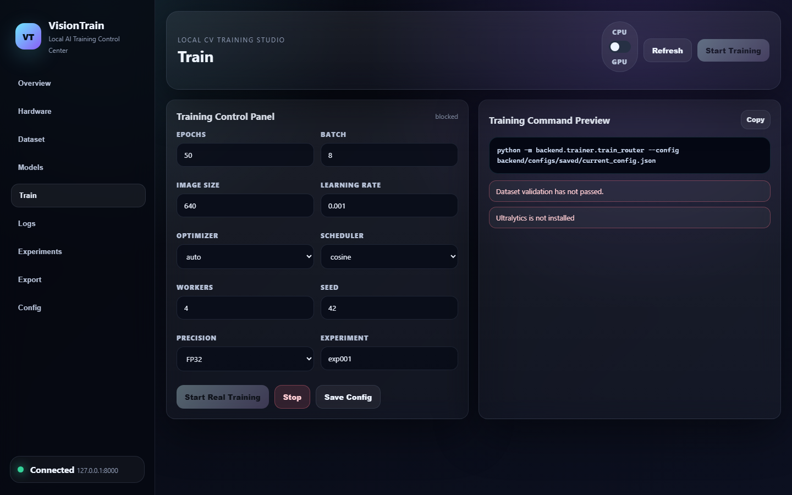
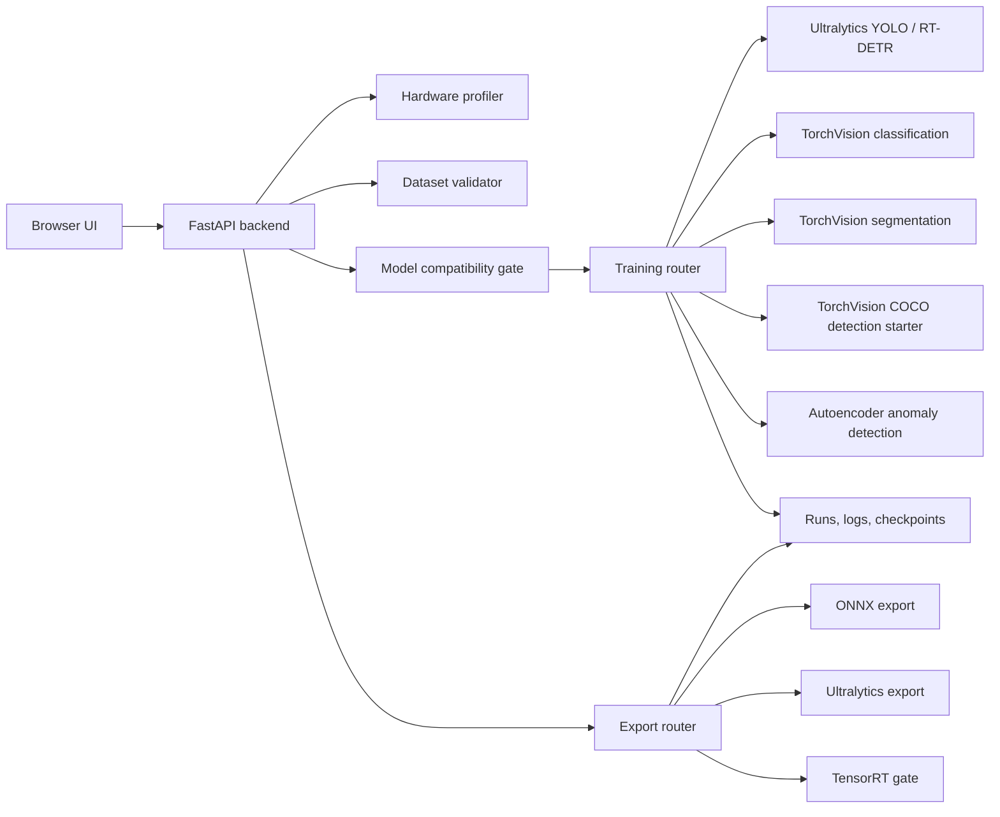

# VisionTrain Studio


VisionTrain Studio is a local computer vision training control center. It gives you a browser UI for dataset validation, hardware checks, model selection, training launch, live logs, experiment history, and model export.

The app runs locally with a static HTML/CSS/JavaScript frontend and a FastAPI backend. Training and export jobs run on your own Python environment.

## Reviewer Quick Path

For a fast job-review pass:

```bash
python scripts/demo_smoke_check.py
pytest
```

The smoke check validates the included demo ImageFolder dataset, writes a demo config, and reports whether the local environment has the packages needed for a one-epoch training proof. After setup, run:

```bash
python scripts/demo_smoke_check.py --train
```

More review notes are in [docs/reviewer_guide.md](docs/reviewer_guide.md).

## Screenshots







## Workflow



## Main Features

- Local FastAPI backend with no cloud dependency
- Static frontend dashboard for repeated training workflows
- CPU/GPU hardware profile with CUDA, VRAM, ONNX, and TensorRT checks
- Dataset validation before training starts
- Model registry with compatibility rules
- Training router for supported trainers
- Live log polling and experiment history
- ONNX, Ultralytics, TensorRT-gated, and precision conversion export paths
- Windows setup and launcher scripts
- Demo dataset, smoke-check script, and pytest coverage for reviewer verification

## Supported Training Paths

| Area | What runs |
|---|---|
| Ultralytics | YOLO detection, YOLO segmentation, YOLO classification, YOLO pose, RT-DETR when supported by the installed Ultralytics package |
| PyTorch / TorchVision classification | ResNet, MobileNetV3, EfficientNet, ConvNeXt, ViT-style ImageFolder training |
| TorchVision semantic segmentation | DeepLabV3, FCN, and LR-ASPP with image/mask folders |
| TorchVision detection starter | Faster R-CNN, RetinaNet, and SSD with COCO-style annotations |
| Anomaly detection | Convolutional autoencoder trained on normal/anomaly folders |

The registry also shows disabled future entries. Disabled models are visible in the UI but cannot be launched until a real trainer is added.

## Requirements

- Windows 10/11
- Python 3.10 or newer
- Conda is recommended; `.venv` fallback is supported
- NVIDIA GPU is optional
- Valid local datasets for training

Core Python packages are listed in [backend/requirements.txt](backend/requirements.txt).

## Setup

Run the Windows setup script:

```bat
scripts\setup_windows.bat
```

The script creates a `visiontrain` Conda environment when Conda is available. If Conda is not installed, it creates `.venv`.

## Start The App

```powershell
powershell -ExecutionPolicy Bypass -File scripts/start_visiontrain.ps1
```

The launcher starts:

- Backend: `http://127.0.0.1:8000`
- Frontend: `http://127.0.0.1:5173`

Runtime logs are written to:

- `backend/logs/backend_runtime.log`
- `backend/logs/frontend_runtime.log`

To stop manually:

```powershell
powershell -ExecutionPolicy Bypass -File scripts/stop_visiontrain.ps1
```

## Training Flow

1. Start the app.
2. Open Dataset.
3. Enter a local dataset path.
4. Choose the dataset format.
5. Validate the dataset.
6. Open Models.
7. Select an enabled model.
8. Set training parameters.
9. Start training.
10. Watch logs and review experiment history.

Equivalent CLI preview:

```bash
python -m backend.trainer.train_router --config backend/configs/saved/current_config.json
```

## Dataset Formats

### YOLO Detection / Segmentation / Pose

```text
dataset/
  dataset.yaml
  images/
    train/
    val/
  labels/
    train/
    val/
```

### Classification

```text
dataset/
  train/
    class_a/
    class_b/
  val/
    class_a/
    class_b/
```

### Semantic Segmentation

```text
dataset/
  images/
    train/
    val/
  masks/
    train/
    val/
```

### COCO Detection

```text
dataset/
  images/
    train/
    val/
  annotations/
    train.json
    val.json
```

### Anomaly Detection

```text
dataset/
  train/
    normal/
  val/
    normal/
    anomaly/
```

## Export

The export center validates the checkpoint path and local dependencies before running.

Supported paths include:

- PyTorch classification/anomaly checkpoint to ONNX
- Ultralytics checkpoint to ONNX, TorchScript, or OpenVINO when supported locally
- TensorRT engine export only when CUDA and TensorRT are detected
- PyTorch FP16 checkpoint conversion for compatible state dictionaries

Example:

```bash
python -m backend.exporter.export_router --checkpoint backend/runs/exp001/best.pt --format onnx --precision fp32 --imgsz 640 --opset 17
```

## API Endpoints

| Method | Endpoint | Purpose |
|---|---|---|
| GET | `/api/health` | Service health and trainer mapping |
| GET | `/api/hardware-profile` | CPU/GPU/package profile |
| GET | `/api/model-compatibility` | Enabled/disabled model list |
| POST | `/api/validate-dataset` | Dataset validation |
| POST | `/api/start-training` | Launch selected trainer |
| POST | `/api/stop-training` | Request training stop |
| GET | `/api/training-status` | Training state and metrics |
| GET | `/api/training-logs` | Live training logs |
| GET | `/api/experiments` | Experiment history |
| POST | `/api/export/onnx` | ONNX export |
| POST | `/api/export/tensorrt` | TensorRT export gate |
| POST | `/api/export/torchscript` | TorchScript export |
| POST | `/api/export/openvino` | OpenVINO export through Ultralytics |
| POST | `/api/export/precision` | Precision conversion |

## Project Structure

```text
VisionTrain-Studio/
  backend/
    main.py
    configs/
    trainer/
    exporter/
    runs/
    logs/
  frontend/
    index.html
    style.css
    app.js
  docs/
    architecture.md
    dataset_formats.md
    export_guide.md
    reviewer_guide.md
    troubleshooting.md
    screenshots/
  demo/
    classification_dataset/
  scripts/
    setup_windows.bat
    start_visiontrain.ps1
    stop_visiontrain.ps1
    demo_smoke_check.py
  tests/
  .github/workflows/python-checks.yml
  README.md
```

## Local Checks

Useful commands before committing changes:

```bash
python -m compileall backend
python -m backend.trainer.train_router --check-mapping
python scripts/demo_smoke_check.py
pytest
```

The GitHub workflow also compiles backend modules, validates JSON configs, imports the API, checks model-to-trainer mapping, and runs pytest.
